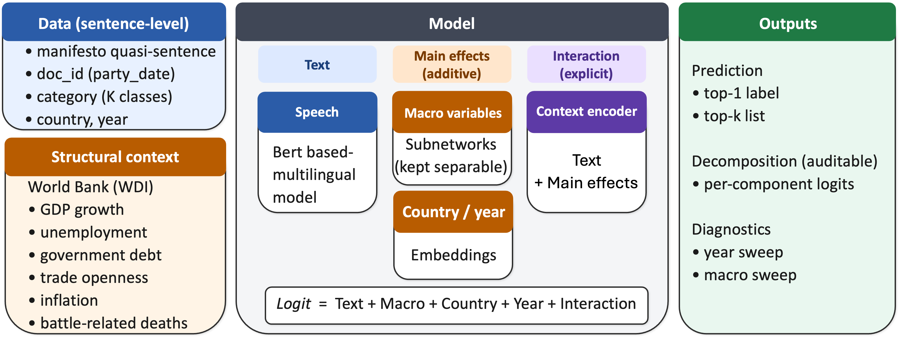

# GBERT

Choose the branch that matches your current goal:

- [Branch A: Model Introduction](#branch-a-model-introduction)
- [Branch B: Application](#branch-b-application)
- [Branch C: Try our online tool](https://gbert.org).
---

## Branch A: Model Introduction

This branch preserves the current research and model-design oriented documentation.

### Overview

A BERT-based model for political text analysis with **structural macro context** and **interpretable logit decomposition**.

This project introduces a hybrid framework that integrates:

- Sentence-level political text (manifesto quasi-sentences)
- Structural macroeconomic variables (World Bank indicators)
- Country and temporal embeddings
- Explicit interaction modeling

The goal is to move beyond pure text classification and enable **causal-style interpretation of political discourse under structural constraints**.

### Pipeline

<p align="left">
  
</p>

1. Text -> BERT backbone -> feature embedding
2. Context encoder integrates macro + country + year
3. FiLM modulation injects structural signals into text features
4. Interaction head models cross-effects
5. Final output = decomposed logits (auditable)

### Model Design

<p align="left">
  
</p>

The model decomposes prediction logits into additive components:

`Logit = f(text) + f(macro) + f(country) + f(year) + f(interaction)`

Key properties:

- **Text encoder**: multilingual BERT backbone
- **Macro module**: separable subnetworks (NAM-style)
- **Country/Year**: embedding-based fixed effects
- **Interaction module**: FiLM-style modulation + explicit classifier

### Temporal Dynamics


**Year-specific shifts in predicted issue emphasis for a fixed sentence.**

Predicted class probabilities for the Japanese sentence. "ワクチン接種の強化が急務だ" ("Strengthening vaccination is an urgent task").
As a function of year, with the text held constant and only the model's year effect applied.
A pronounced discontinuity is observed around 2021, where probability mass shifts from the welfare-state expansion category (504) toward the law-and-order category (605), consistent with pandemic-era reweighting of vaccination-related framing.

### Quickstart

1. Create an environment and install deps

```bash
python -m venv .venv
source .venv/bin/activate
pip install -r requirements.txt
```

2. Put data at the root

The preprocessing expects at least these columns:

- `sentence`, `category`, `country`, `year`
- macro columns: `battle_value`, `gdp_value`, `trade_value`, `debt_value`, `inflation_value`, `unemployment_value`

3. Preprocess to produce `train.csv`, `val.csv`, `preprocess_meta.joblib`

```bash
python scripts/preprocess.py
```

4. Train

```bash
python scripts/train.py --epochs 5
```

For a tiny debug run:

```bash
python scripts/train.py --debug_n 256 --epochs 1 --batch_size 16 --val_batch_size 16
```

---

## Branch B: Application

This branch is written for direct use of the published package and follows the PyPI application guide in a more detailed form.

### Installation

Install the base package:

```bash
pip install gbert
```

For UMAP and plotting:

```bash
pip install umap-learn matplotlib seaborn
```

### Coverage Note

The package is designed for country-year inference with temporal coverage extending through 2023 in standard use. The built-in demo corpus is an illustrative multilingual sample covering Japan, the United States, and Germany for 1996-2018.

### End-to-End Application Workflow

#### 1. Install in a notebook or local environment

```python
!pip -q install gbert
```

#### 2. Import and initialize

```python
from gbert import GbertClassifier, load_demo_corpus_ja_us_de_1996_2018

model = GbertClassifier(
    model_repo_id="X-Li/gbert",
    # device="cpu",
)
```

`GbertClassifier` is the main runtime entry point. It loads:

- the text backbone
- the trained classifier weights
- metadata for countries, years, labels, and macro variables

#### 3. Load the built-in demo corpus

```python
demo = load_demo_corpus_ja_us_de_1996_2018()
texts = demo["text"].tolist()
countries = demo["country"].tolist()
years = demo["year"].tolist()
party_family = demo["party_family"].tolist()
```

The demo `DataFrame` contains:

- `text`
- `country`
- `year`
- `party_family`

#### 4. Single prediction

```python
single = model.predict(
    "政府は先端産業への投資を強化する。",
    country="Japan",
    year=2026,
)
print(single["predictions"][:3])
```

Use this when you want one sentence at a time. The returned object includes:

- ranked CMP predictions
- `cmp_code`
- `cmp_title`
- prediction probability
- macro values used at inference time

#### 5. Batch prediction

```python
batch = model.predict_batch(
    texts=texts,
    country=countries,
    year=years,
    return_df=True,
)
print(batch.head())
```

Use `predict_batch()` when you already have a corpus and want compact output. With `return_df=True`, the returned `DataFrame` is easier to inspect and merge.

#### 6. CMP code lookup

```python
print(model.get_cmp_info(305))
print(model.list_cmp_codes()[:10])
```

Use:

- `get_cmp_info(code)` for one CMP code
- `list_cmp_codes()` for the full supported label space

#### 7. Corpus analysis

```python
analysis = model.analyze_corpus(
    texts=texts,
    country=countries,
    year=years,
    include_probabilities=True,
)
print(analysis.columns[:20])
print(analysis[["country", "year", "top_cmp_code", "top_cmp_title", "top_probability", "entropy"]].head())
```

This is the main text-level analysis API. It produces a text-level `DataFrame` with:

- top predicted CMP code and title
- top probability
- entropy
- confidence margin
- ranked prediction objects
- optional posterior columns `p_<cmp_code>`

#### 8. Topic profile

```python
profile = model.compute_topic_profile(
    texts=texts,
    country=countries,
    year=years,
)
print(profile.head(10))
```

This aggregates sentence-level posterior probabilities into a corpus-level CMP profile.

#### 9. Bootstrap topic profile

```python
bootstrap = model.bootstrap_topic_profile(
    texts=texts,
    country=countries,
    year=years,
    n_bootstrap=100,
)
print(bootstrap.head(10))
```

Use this for uncertainty intervals around the corpus topic profile.

#### 10. Group comparison

```python
comparison = model.compare_groups(
    texts=texts,
    country=countries,
    year=years,
    group=party_family,
)
print(comparison["group_summary"])
print(comparison["pairwise_divergence"].head())
```

This compares any user-defined grouping variable, not only country.

#### 11. Country profile comparison

```python
country_comparison = model.compare_country_profiles(
    texts=texts,
    country=countries,
    year=years,
)
print(country_comparison["group_summary"].head())
```

This is the country-level convenience wrapper around `compare_groups()`.

#### 12. Country-year panel

```python
panel = model.panelize_country_year(
    texts=texts,
    country=countries,
    year=years,
)
print(panel.head())
```

This converts text-level predictions into a country-year panel with topic score columns such as `score_401`, `score_504`, and so on.

#### 13. Methods-summary export

```python
methods = model.export_methods_summary(
    texts=texts,
    country=countries,
    year=years,
)
print(methods.keys())
print(methods["methods_text"])
```

Use this when you want:

- sample summary
- prediction quality summary
- top topics
- a ready-to-edit methods paragraph

#### 14. Raw UMAP projection

```python
umap_df = model.project_umap(
    texts=texts,
    country=countries,
    year=years,
)
print(umap_df.head())
```

By default this uses the context-conditioned text representation `cls_film`. You can also use:

- `representation="cls"`
- `representation="logits"`
- `representation="probabilities"`

#### 15. UMAP plot

```python
fig, ax, umap_frame = model.plot_umap(
    texts=texts,
    country=countries,
    year=years,
    color_by="country",
    annotate=False,
)
```

This directly produces a seaborn-based scatter figure and returns:

- `fig`
- `ax`
- the plotted frame

#### 16. Topic profile plot

```python
fig, ax = model.plot_topic_profile(
    profile,
    top_n=12,
    title="Corpus Topic Profile",
)
```

#### 17. Group divergence heatmap

```python
fig, ax, divergence_matrix = model.plot_group_divergence(
    comparison["pairwise_divergence"],
    title="Party Family Divergence",
)
```

#### 18. Topic heatmap from the panel

```python
fig, ax, heatmap = model.plot_topic_heatmap(
    panel,
    topics=[401, 504, 106],
    title="Selected Topic Heatmap",
)
```

#### 19. Temporal trend plot

```python
fig, ax, trend_df = model.plot_temporal_trends(
    panel,
    countries=["Japan", "United States", "Germany"],
    title="Temporal Topic Trends",
)
```

#### 20. Ridgeplot from text-level analysis

```python
g = model.plot_topic_ridgeplot(
    analysis,
    topics=[504],
    title="Topic Probability Ridgeplot",
)
```

### Advanced Research APIs

These APIs are designed for comparative inference, uncertainty and robustness analysis, and causal or explanatory diagnostics.

#### Comparative inference

##### `estimate_dynamic_topic_trends(panel, ...)`

```python
dynamic_trends = model.estimate_dynamic_topic_trends(
    panel,
    topics=[401, 504, 106],
    countries=["Japan", "United States", "Germany"],
    smoothing_window=3,
)
print(dynamic_trends.head())

fig, ax, trend_plot_data = model.plot_dynamic_topic_trends(dynamic_trends)
```

Returns a long-format `DataFrame` with:

- `country`
- `year`
- `cmp_code`
- `cmp_title`
- `score`
- `smoothed_score`
- `delta_from_previous`

##### `compare_topic_shifts(panel, ...)`

```python
topic_shifts = model.compare_topic_shifts(
    panel,
    topics=[401, 504, 106],
    group_col="country",
    start_year=1996,
    end_year=2018,
)
print(topic_shifts.head())

fig, ax, topic_shift_plot = model.plot_topic_shifts(topic_shifts)
```

Returns:

- group identifier such as `country`
- `cmp_code`
- `cmp_title`
- `start_year`
- `end_year`
- `start_score`
- `end_score`
- `absolute_change`
- `relative_change`

##### `compute_topic_convergence(panel, ...)`

```python
convergence = model.compute_topic_convergence(
    panel,
    topics=[401, 504, 106],
)
print(convergence["yearly_summary"].head())
print(convergence["pairwise_divergence"].head())

fig, axes, convergence_plot = model.plot_topic_convergence(convergence)
```

Returns a dictionary with:

- `yearly_summary`
- `pairwise_divergence`

#### Uncertainty and robustness

##### `summarize_prediction_uncertainty(texts, country, year, ...)`

```python
uncertainty = model.summarize_prediction_uncertainty(
    texts=texts,
    country=countries,
    year=years,
    group=party_family,
    entropy_quantile=0.75,
    margin_quantile=0.25,
)
print(uncertainty["summary"])
print(uncertainty["group_summary"].head())

fig, ax, uncertainty_plot = model.plot_prediction_uncertainty(uncertainty)
```

Returns:

- `summary`
- `text_level`
- `group_summary`

##### `assess_topic_stability(texts, country, year, ...)`

```python
stability = model.assess_topic_stability(
    texts=texts,
    country=countries,
    year=years,
    n_bootstrap=200,
    top_k=10,
)
print(stability.head())

fig, ax, stability_plot = model.plot_topic_stability(stability)
```

Returns:

- `cmp_code`
- `cmp_title`
- `mean_score`
- `score_std`
- `rank_mean`
- `rank_std`
- `top_k_frequency`

#### Causal and explanatory diagnostics

##### `decompose_prediction_components(texts, country, year, ...)`

```python
components = model.decompose_prediction_components(
    texts=texts[:5],
    country=countries[:5],
    year=years[:5],
    top_k=3,
)
print(components.head())

fig, ax, component_plot = model.plot_prediction_components(components, text_index=0, rank=1)
```

Returns:

- `text`
- `country`
- `year`
- `rank`
- `cmp_code`
- `cmp_title`
- `probability`
- `logit_total`
- `logit_text`
- `logit_macro`
- `logit_country`
- `logit_year`
- `logit_interaction`

##### `simulate_counterfactuals(text, country, year, ...)`

```python
counterfactuals = model.simulate_counterfactuals(
    text="The government should expand industrial investment and modern infrastructure.",
    country="Japan",
    year=2018,
    counterfactual_countries=["Germany", "United States"],
    counterfactual_years=[2000, 2010],
    top_k=3,
)
print(counterfactuals.head(12))

fig, ax, counterfactual_plot = model.plot_counterfactuals(counterfactuals, rank=1)
```

Returns:

- `scenario`
- `country`
- `year`
- `rank`
- `cmp_code`
- `cmp_title`
- `probability`
- `delta_vs_observed`

##### `estimate_macro_effects(texts, country, year, ...)`

```python
macro_effects = model.estimate_macro_effects(
    texts=texts,
    country=countries,
    year=years,
    topic_codes=[401, 504, 106],
    step_size=0.5,
)
print(macro_effects.head())

fig, ax, macro_effect_plot = model.plot_macro_effects(macro_effects)
```

Returns:

- `macro_variable`
- `cmp_code`
- `cmp_title`
- `baseline_probability`
- `delta_plus`
- `delta_minus`
- `symmetric_effect`

### Main interfaces

- `predict(...)`
- `predict_batch(...)`
- `analyze_corpus(...)`
- `compute_topic_profile(...)`
- `bootstrap_topic_profile(...)`
- `compare_groups(...)`
- `compare_country_profiles(...)`
- `panelize_country_year(...)`
- `project_umap(...)`
- `plot_umap(...)`
- `plot_topic_profile(...)`
- `plot_group_divergence(...)`
- `plot_topic_heatmap(...)`
- `plot_topic_ridgeplot(...)`
- `plot_temporal_trends(...)`
- `export_methods_summary(...)`
- `estimate_dynamic_topic_trends(...)`
- `plot_dynamic_topic_trends(...)`
- `compare_topic_shifts(...)`
- `plot_topic_shifts(...)`
- `compute_topic_convergence(...)`
- `plot_topic_convergence(...)`
- `summarize_prediction_uncertainty(...)`
- `plot_prediction_uncertainty(...)`
- `assess_topic_stability(...)`
- `plot_topic_stability(...)`
- `decompose_prediction_components(...)`
- `plot_prediction_components(...)`
- `simulate_counterfactuals(...)`
- `plot_counterfactuals(...)`
- `estimate_macro_effects(...)`
- `plot_macro_effects(...)`
- `get_cmp_info(...)`
- `list_cmp_codes(...)`
- `load_demo_corpus_ja_us_de_1996_2018()`

The default text backbone is `bert-base-multilingual-cased`.

### CMP code reference

The CMP labels exposed by `get_cmp_info()` and `list_cmp_codes()` follow the Comparative Manifesto Project coding scheme. For code definitions and the underlying coding framework, cite the Comparative Manifesto Project dataset and codebook in substantive applications.
