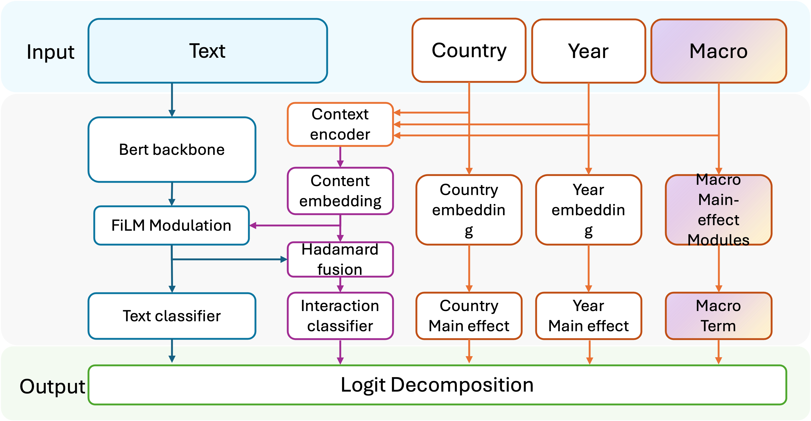
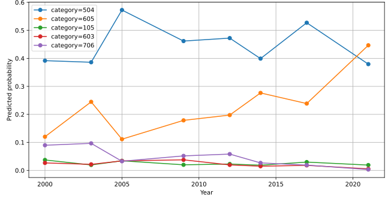

# GBERT

A BERT-based model for political text analysis with **structural macro context** and **interpretable logit decomposition**.

---

## Overview

This project introduces a hybrid framework that integrates:

- Sentence-level political text (manifesto quasi-sentences)
- Structural macroeconomic variables (World Bank indicators)
- Country and temporal embeddings
- Explicit interaction modeling

The goal is to move beyond pure text classification and enable **causal-style interpretation of political discourse under structural constraints**.

---

## Pipeline
<p align="left">
  
</p>

1. Text → BERT backbone → feature embedding  
2. Context encoder integrates macro + country + year  
3. FiLM modulation injects structural signals into text features  
4. Interaction head models cross-effects  
5. Final output = decomposed logits (auditable)

---

## Model Design

<p align="left">
  
</p>
The model decomposes prediction logits into additive components:

Logit = f(text) + f(macro) + f(country) + f(year) + f(interaction)

Key properties:

- **Text encoder**: multilingual BERT backbone  
- **Macro module**: separable subnetworks (NAM-style)  
- **Country/Year**: embedding-based fixed effects  
- **Interaction module**: FiLM-style modulation + explicit classifier  

---


## Temporal Dynamics



**Year-specific shifts in predicted issue emphasis for a fixed sentence.**

Predicted class probabilities for the Japanese sentence. “ワクチン接種の強化が急務だ” (“Strengthening vaccination is an urgent task”).
As a function of year, with the text held constant and only the model’s year effect applied.
A pronounced discontinuity is observed around 2021, where probability mass shifts from the welfare-state expansion category (504) toward the law-and-order category (605), consistent with pandemic-era reweighting of vaccination-related framing.

## Quickstart

1) Create an environment and install deps

```bash
python -m venv .venv
source .venv/bin/activate
pip install -r requirements.txt
```

2) Put data at the root:

The preprocessing expects at least these columns:
- `sentence`, `category`, `country`, `year`
- macro columns: `battle_value`, `gdp_value`, `trade_value`, `debt_value`, `inflation_value`, `unemployment_value`

3) Preprocess to produce `train.csv`, `val.csv`, `preprocess_meta.joblib`

```bash
python scripts/preprocess.py
```

4) Train

```bash
python scripts/train.py --epochs 5
```

For a tiny debug run:

```bash
python scripts/train.py --debug_n 256 --epochs 1 --batch_size 16 --val_batch_size 16
```

